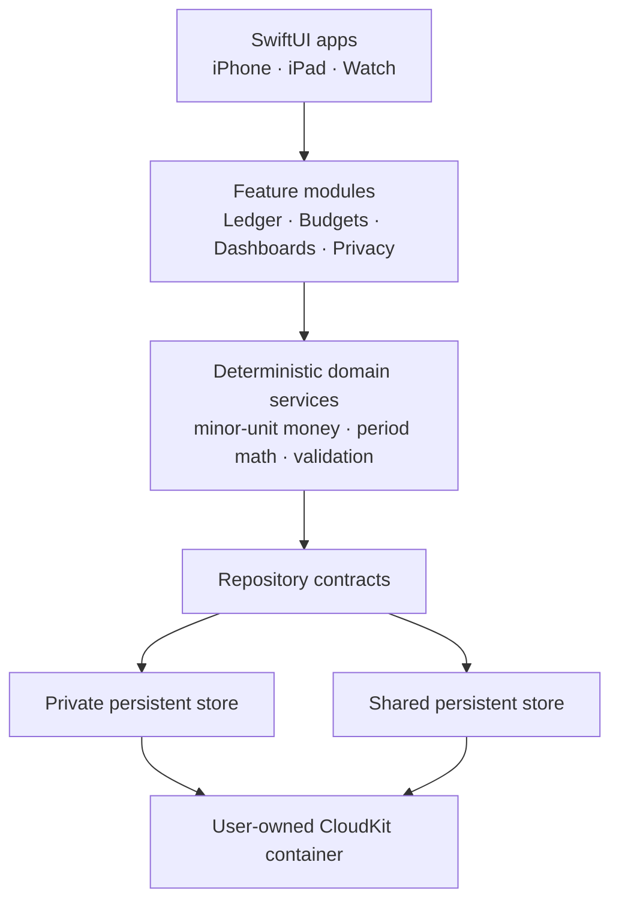

# Architecture

TBB is an Apple-native, local-first modular monolith implemented in Swift. iPhone is the primary interaction surface; iPad expands analysis and planning; Watch supports focused capture and safe glanceability.

## Storage decision

TBB uses Core Data backed by `NSPersistentCloudKitContainer`, with separate private and shared stores. This is intentional: Apple’s supported model for multi-user CloudKit sharing requires private/shared stores, history tracking, and remote-change handling. SwiftUI is the UI layer; domain services and repositories remain independent of it.

## Module rules

| Module | May depend on | Must not depend on |
|---|---|---|
| Domain | Foundation | SwiftUI, Core Data, CloudKit, platform UI |
| Application | Domain, contracts | concrete UI |
| Persistence | Domain contracts, Core Data/CloudKit | SwiftUI |
| Platform UI | Application, design system | persistence implementation |
| Security | contracts, Security/LocalAuthentication | feature views |
| Backup | Domain contracts, CryptoKit | UI implementations |

Architecture tests will enforce no reverse dependencies.

## Household-sharing boundary

A `BudgetSpace` is either `private` or `shared`. A shared space forms one CloudKit shareable object graph: accounts, transactions, categories, rules, and audit entries belong to that space. Cross-space relationships are forbidden. Sharing starts through Apple system UI with invite-only access; acceptance is handled as an explicit app lifecycle event.

## Performance rules

- Use aggregate projections and bounded caches for dashboard cards; do not load the full ledger to render a card.
- Recompute only affected periods after mutation.
- Background work is cancellable and observable.
- Long-session memory, cold launch, and dashboard-render operation budgets are tested with deterministic fixtures.
