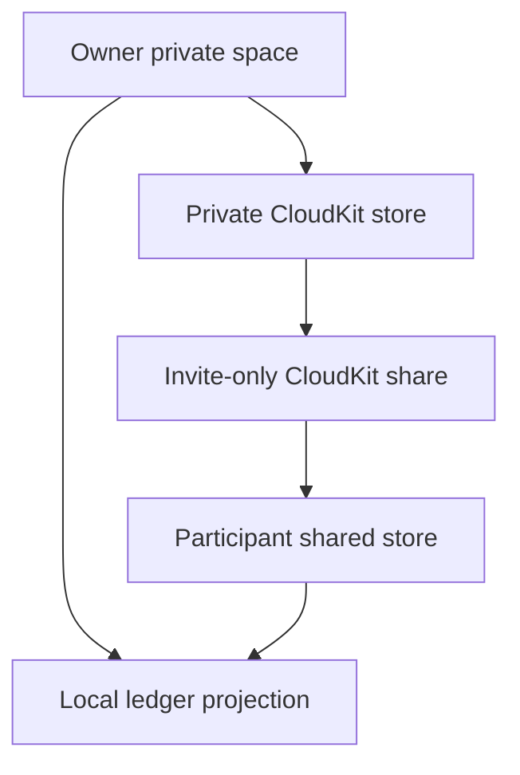

# Architecture

TBB is an Apple-native, local-first modular monolith implemented in Swift. iPhone is the primary interaction surface; iPad expands analysis and planning; Watch supports focused capture and safe glanceability.

## Storage decision

TBB uses Core Data backed by `NSPersistentCloudKitContainer`, with separate private and shared stores. SwiftUI is the UI layer; domain services and repositories remain independent of it.

M2 persists a versioned canonical `LedgerState` snapshot through Core Data. M4 extends that snapshot with budget plans; decoding an older snapshot defaults the missing collection to empty. M5 replaces the snapshot adapter with a space-scoped append-only mutation repository: it keeps a derived `LedgerState` projection for existing UI contracts while making synchronization idempotent and auditable.

Budget plans are deterministic projections over ledger transactions. They never manufacture transactions or change the ledger to represent a plan. Local notifications are a device-only presentation adapter: their identifiers and payloads contain no amounts, and they have no server or CloudKit dependency.

## Household-sharing boundary

A `BudgetSpace` is either private or shared. A shared space is one CloudKit shareable object graph: mutation log, accounts, transactions, categories, budget plans, and audit entries belong to that space. Cross-space relationships are forbidden.

The CloudKit share is Apple-managed infrastructure, not a TBB service. There is no public financial-data database and no TBB identity provider. Each device keeps its own local lock and Privacy Mode state.

## Module rules

| Module | May depend on | Must not depend on |
|---|---|---|
| Domain | Foundation | SwiftUI, Core Data, CloudKit, platform UI |
| Application | Domain, contracts | concrete UI |
| Persistence | Domain contracts, Core Data/CloudKit | SwiftUI |
| Platform UI | Application, design system | persistence implementation |
| Security | contracts, Security/LocalAuthentication | feature views |
| Backup | Domain contracts, CryptoKit | UI implementations |

## Performance rules

- Use aggregate projections and bounded caches for dashboard cards; do not load the full ledger to render a card.
- Recompute only affected periods after mutation.
- Background work is cancellable and observable.
- Long-session memory, cold launch, and dashboard-render operation budgets are tested with deterministic fixtures.
